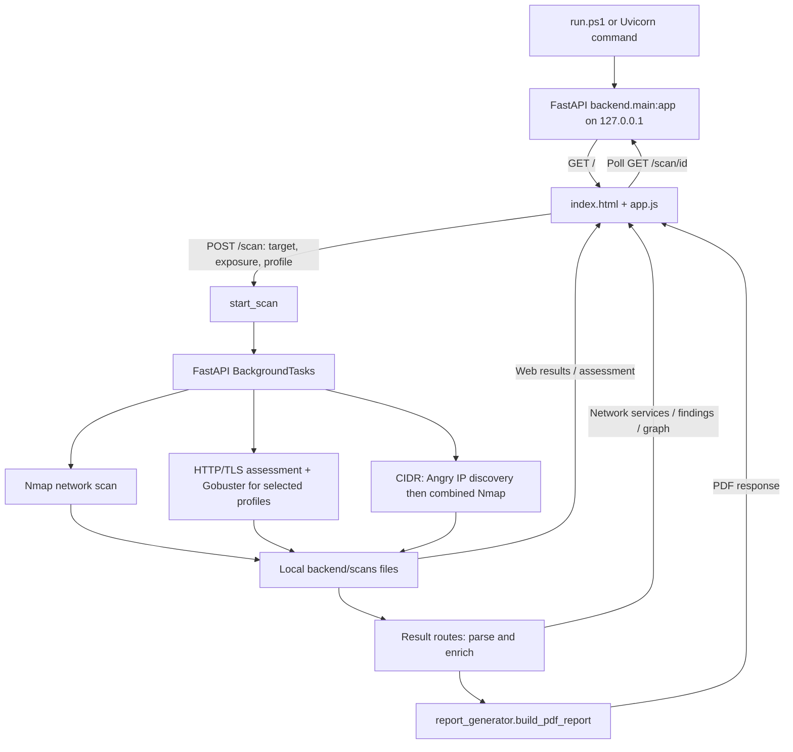

# Day 1 — working RiskLens baseline

Verified on 2026-11-16. Scope: inspect, launch, document. No application,
dependency, scanner, or launcher changes. The existing application successfully
started on `127.0.0.1:8787` using the installed baseline virtual environment.
No scans or active result/enrichment routes were invoked.

## Source and ZIP identity

The [backend ZIP](../backend-20261016T162918Z-1-001.zip) contains 40 entries and
the [frontend ZIP](../frontend-20261016T162919Z-1-001.zip) contains four. The
frontend is byte-identical to the extracted working copy. Six backend Python
files are byte-identical; the credential module differs only in comments; the
main module additionally imports response classes from Starlette rather than
FastAPI. These differences predate this work. We ran the existing working copy
without restoring the archive or overwriting its edits.

[DAY-01.md](./DAY-01.md) has the full 18-route inventory, profile matrix, and
inspection evidence. [day1-inspection.json](../artifacts/day1-inspection.json)
contains hashes, archive comparisons, source differences, and call sites.

Relevant tree (generated environments, bytecode, and unrelated archive contents
omitted):

```text
RiskLens/
|-- run.ps1
|-- requirements.txt
|-- README.md
|-- backend/
|   |-- main.py
|   |-- llm_remediation.py
|   |-- report_generator.py
|   |-- scanner/
|   |   |-- weak_creds.py
|   |   |-- nvd_client.py
|   |   |-- nvd_mapping.py
|   |   |-- pcvp_scoring.py
|   |   `-- attack_graph.py
|   `-- scans/
|       |-- scan_status.json
|       |-- <scan_id>.xml
|       |-- gobuster_<scan_id>.txt / .status / .done
|       `-- web_audit_<scan_id>.json
|-- frontend/
|   |-- templates/
|   |   |-- index.html
|   |   `-- base.html
|   `-- static/
|       |-- app.js
|       `-- css/style.css
|-- gobuster_Windows_x86_64/gobuster.exe
|-- wordlists/common.txt
`-- llm_cache.json
```

## Real execution path



The diagram describes current behavior. Result enrichment currently includes
active credential attempts and external NVD calls on several routes; those
behaviors are not part of the baseline smoke test.

1. [run.ps1](../run.ps1) selects `.venv/Scripts/python.exe` and starts
   `uvicorn backend.main:app --host 127.0.0.1 --port 8787 --reload`.
   [main.py](../backend/main.py#L480) constructs the FastAPI application; its
   lifespan handler loads saved scan metadata into memory.
2. `GET /` renders [index.html](../frontend/templates/index.html). This is a
   standalone template with inline styles and CDN assets; it does not extend
   [base.html](../frontend/templates/base.html) or use the small existing
   [style.css](../frontend/static/css/style.css).
3. The submit listener in [app.js](../frontend/static/app.js#L287) sends JSON
   `{target, exposure, profile}` to `POST /scan`. The API additionally accepts
   ports and description. It returns a scan ID and pending status.
4. [start_scan](../backend/main.py#L566) creates metadata and adds background
   tasks. A single target goes to `run_nmap_scan`; all profiles except quick
   also queue `run_gobuster_scan`. Tasks added to this response run sequentially:
   Nmap first, then the web task. They are not a durable job queue.
5. [run_nmap_scan](../backend/main.py#L517) calls `subprocess.run` with an argument
   list and XML output. Standard/web use `-sV -T4 -Pn`; quick omits `-sV`.
   Vulnerability/full additionally use OS detection and `--script vuln`.
   CIDR uses Angry IP Scanner followed by combined Nmap; that path currently
   runs the vulnerability script set regardless of the selected profile.
6. [run_gobuster_scan](../backend/main.py#L1044) first runs the Requests/socket
   HTTP/TLS assessment, saves its JSON, then invokes Gobuster `dir` with the
   common wordlist, 30 threads, disabled TLS verification, and a 300-second
   process timeout. It writes output, warnings, and a completion marker.
7. The browser polls `GET /scan/{id}`. After completion it loads services from
   `/scan/{id}/nvd`, findings, alive hosts, graph, and the separate web results
   and assessment routes. Historical scans use these same loaders.
8. The PDF button navigates to `/scan/{id}/report.pdf`.
   [download_report](../backend/main.py#L1323) parses XML, annotates credentials,
   queries NVD, scores services, and builds findings and a graph before calling
   [build_pdf_report](../backend/report_generator.py#L31). ReportLab builds PDF
   bytes in memory; FastAPI streams them as `application/pdf`. There is no saved
   PDF file by default. CSV uses the findings route and Python's CSV writer.
   PDF findings currently omit the web-audit input used by JSON/CSV findings.

### Scanner helpers and storage

| Existing module | Role |
|---|---|
| [nvd_client.py](../backend/scanner/nvd_client.py) | Requests to the public NVD API, optional `NVD_API_KEY`. |
| [nvd_mapping.py](../backend/scanner/nvd_mapping.py) | Builds a product/version keyword and extracts candidate CVEs. |
| [pcvp_scoring.py](../backend/scanner/pcvp_scoring.py) | Heuristic service/exposure/credential/CVE score. |
| [weak_creds.py](../backend/scanner/weak_creds.py) | SSH, FTP, and HTTP Basic credential attempts; must be removed from automatic reads. |
| [attack_graph.py](../backend/scanner/attack_graph.py) | Host/service/CVE nodes and speculative high-score chain edges. |

[backend/scans](../backend/scans) stores network XML, web JSON, Gobuster text and
status markers, and persisted scan metadata. CIDR scans can also produce
`angryip_<id>.csv` and `alive_<id>.json`. Metadata is held in an in-memory dict
and persisted to [scan_status.json](../backend/scans/scan_status.json), using a
temporary file and replace. Clearing history preserves raw result files.
There is no active SQL database path despite installed SQLAlchemy/aiosqlite.

Browser localStorage caches the selected scan, services, rendered HTML,
statistics, graph, and remediation. [llm_remediation.py](../backend/llm_remediation.py)
uses [llm_cache.json](../llm_cache.json) relative to process working directory.
These are mutable caches, not immutable scan snapshots. Network and web outputs
have separate endpoints/files, but findings combine them without a domain field.

## Dependencies and Windows paths

Install the unchanged [requirements.txt](../requirements.txt). Important direct
runtime packages are FastAPI 0.123.10, Uvicorn 0.38.0, Starlette 0.50.0,
Pydantic 2.12.5, Jinja2 3.1.6, xmltodict 1.0.2, Requests 2.32.5, ReportLab 4.4.7,
Paramiko 4.0.0, and google-genai 1.64.0. The last two are still needed by existing
imports even though credential/AI operations are excluded from today's tests.
Do not configure Gemini credentials for this baseline.

The file also pins support packages and SQLAlchemy/aiosqlite/greenlet, although
the inspected storage path does not use the database packages. No npm build
step is present. Python 3.14.3 is the interpreter actually verified here; this
does not certify other Python versions.

| Dependency / location | Configuration | Local check |
|---|---|---|
| Nmap | Hard-coded `C:\Program Files (x86)\Nmap\nmap.exe` in [main.py](../backend/main.py#L46) | Present; scanner execution not tested. |
| Angry IP Scanner, CIDR only | Hard-coded `C:\Tools\AngryIP\ipscan.exe` in [main.py](../backend/main.py#L47) | Missing. CIDR is not verified. |
| Gobuster | Project-relative `gobuster_Windows_x86_64/gobuster.exe` | Present; executable not run. |
| Wordlist | Project-relative `wordlists/common.txt` | Present. |
| Optional credential wordlist | Project-relative `wordlists/rockyou.txt`, with built-in fallback | Not needed or used for baseline. |
| Templates/static/scans | Derived from `Path(__file__)`, not an absolute machine path | Local root/static requests passed. |
| Launcher interpreter | Project-relative `.venv/Scripts/python.exe` | Launcher requires that environment name. |
| Browser assets | Tailwind on cdn.tailwindcss.com; vis-network JS/CSS on unpkg.com | External network required for full current styling/graph; not fetched today. |
| NVD / Gemini | External APIs, optional environment keys | No requests made today. |

The old README includes another machine's `F:\kale\PCVP` setup path. Use the
actual project location below. The app is not yet fully offline/local-first.

## Exact PowerShell setup, launch, and health test

For a new independent environment, run in PowerShell. This leaves both existing
environments intact. The Python launcher `py` must already be installed.

```powershell
Set-Location 'D:\security project'
py -3 -m venv .venv-risklens-v2
& '.\.venv-risklens-v2\Scripts\python.exe' -m pip install --upgrade pip
& '.\.venv-risklens-v2\Scripts\python.exe' -m pip install -r '.\requirements.txt'
& '.\.venv-risklens-v2\Scripts\python.exe' -m pip check

Test-Path 'C:\Program Files (x86)\Nmap\nmap.exe'
Test-Path 'C:\Tools\AngryIP\ipscan.exe'
Test-Path '.\gobuster_Windows_x86_64\gobuster.exe'
Test-Path '.\wordlists\common.txt'

& '.\.venv-risklens-v2\Scripts\python.exe' -B -m uvicorn backend.main:app --host 127.0.0.1 --port 8787
```

No activation or execution-policy change is required. Keep the server terminal
open. If today's baseline server is still running on 8787, stop it with Ctrl+C
before launching another on that port. Use `py -3.14` instead of `py -3` if you
have multiple versions and want the version verified today.

The existing launcher is an alternative for a fresh checkout whose environment
is named `.venv`: create it with `py -3 -m venv .venv`, install requirements using
its Python, then run `& '.\run.ps1'`. The launcher does not select the new
`.venv-risklens-v2` environment. Do not overwrite an existing environment to make
its name match the launcher.

In a second PowerShell terminal:

```powershell
$response = Invoke-WebRequest -UseBasicParsing 'http://127.0.0.1:8787/health' -TimeoutSec 15
$response.StatusCode
$response.Content | ConvertFrom-Json | Format-List
(Invoke-WebRequest -UseBasicParsing 'http://127.0.0.1:8787/' -TimeoutSec 15).StatusCode
(Invoke-WebRequest -UseBasicParsing 'http://127.0.0.1:8787/static/app.js?v=18' -TimeoutSec 15).StatusCode
```

Expected: `No broken requirements found.`; Uvicorn reports application startup
complete and `http://127.0.0.1:8787`; each HTTP status is `200`. Health body:

```json
{"status":"ok","service":"risklens-backend","boot_id":"<per-process UUID>"}
```

On this machine the four tool-file checks returned `True`, `False`, `True`,
`True`, respectively. Scanners are not needed for health/root-page startup.
Fresh-environment creation and installation commands are supplied, not claimed
as executed today: the verified launch used the pre-existing baseline environment.

## Baseline testing checklist and observed results

- [x] Compare source ZIPs with the extracted files and preserve existing edits.
- [x] Inspect source and all 18 declared application routes.
- [x] Existing baseline environment: Python 3.14.3; `pip check` passes.
- [x] Launch unchanged app with explicit `--host 127.0.0.1`; startup completes.
- [x] `GET /health`: HTTP 200, expected status/service/boot ID.
- [x] `GET /`: HTTP 200, server-side template render succeeds.
- [x] `GET /static/app.js?v=18`: HTTP 200.
- [x] Recheck all 12 application source hashes: unchanged from inspection.
- [ ] Fresh environment install: commands supplied, not re-run.
- [ ] Browser styling, graph, and JavaScript interaction: not re-tested. Fetching
      HTML does not execute JavaScript or prove browser functionality.
- [ ] Nmap, Gobuster, CIDR, history restoration, CSV/PDF, service details: not
      invoked because current result paths can perform credential attempts or
      external enrichment. Source flow documented; no end-to-end scan claim.
- [ ] Operating-system socket inventory: `Get-NetTCPConnection` was denied in
      this environment. Loopback bind is evidenced by the launch command and
      Uvicorn startup log; socket enumeration was not independently verified.

The existing VS Code task could not be invoked from this tool context, so the
same Python/Uvicorn command was launched directly. No application fix was needed.
[day1-baseline.json](../artifacts/day1-baseline.json) records the repeatable HTTP
checks and startup observations. The existing app is launchable; full assessment
functionality is documented but deliberately unverified today.

## Five most serious issues to resolve

1. **Automatic credential guessing during reads.** Service results, findings,
   exports, and remediation can call credential checks. Remove these calls
   before treating saved history/report viewing as read-only.
2. **No enforced authorized scope.** Scan submission lacks an authorization gate;
   `.0` becomes `/24`; web redirects can leave the original target. Validate and
   persist finite targets/ports; pin approved destinations and reject redirects.
3. **Unexpected intrusive work and inconsistent profiles.** Default standard
   queues directory enumeration; CIDR always adds `--script vuln`; web probing
   disables TLS verification on fallback. Establish conservative consistent
   defaults with explicit opt-in to bounded web discovery.
4. **External/AI dependence conflicts with local-first requirements.** Gemini,
   live NVD enrichment, and CDN assets remain reachable; the Gemini prompt can
   contain credential details. Remove LLM integration, make result reads use
   saved local data, and serve frontend assets locally.
5. **Evidence is overstated and not stable.** Negative NSE output becomes a
   high-confidence finding; keyword CVEs become known vulnerabilities; scores
   and graphs imply unsupported attack paths. Separate observations/candidates
   from supported findings, preserve raw evidence, and build immutable snapshots
   before implementing the Exposure Change Detector.

## Git branch and first commit commands

These are supplied commands; no branch, commit, or push was performed. Existing
branch is `chore/local-baseline`. A dirty working tree already contains source
comments, tracked bytecode changes, metadata, and raw scan files. A branch switch
carries those edits; it does not save or discard them.

```powershell
Set-Location 'D:\security project'
git status --short
git switch -c risklens-v2

# Existing application is already tracked. Commit only today's reviewed baseline deliverables.
git add -- docs/DAY-01.md docs/DAY-01-BASELINE.md tools/inspect_day1.py artifacts/day1-inspection.json artifacts/day1-baseline.json
git diff --cached --stat
git diff --cached
git commit -m 'docs: establish RiskLens v2 working baseline'
git status --short
```

Expected: a new local `risklens-v2` branch and a documentation/inspection commit.
Review the staged diff first, including anything already staged before these
commands. Unrelated source/runtime edits remain uncommitted. Avoid `git add .`:
it could capture sensitive scan output and the new environment (the current
ignore file does not cover `.venv-risklens-v2`). This commit documents the
existing baseline; it does not capture unreviewed pre-existing application edits.

## Changes and stop

Added this baseline guide and its smoke-test JSON record; updated the earlier
Day 1 report to point to this verified launch. No app source, requirements,
launcher, or scanner behavior changed. No AI, cloud analytics, credential
guessing, exploitation, or target scan was performed. Stop after Day 1.
